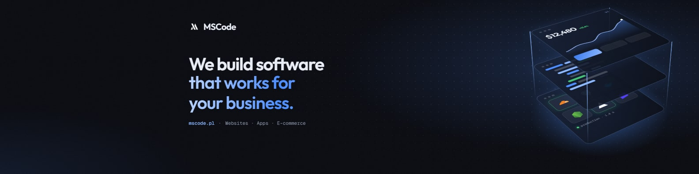

<h3 align="center">Budujemy software, który pracuje na firmę.</h3>

  Strony internetowe, aplikacje webowe, sklepy e-commerce i platformy SaaS. 
  Projektujemy, programujemy, hostujemy i dbamy o nie po wdrożeniu.

  
  
  
  
  
  

---

### `👋` Kim jesteśmy?

**MSCode to Twój zespół IT**: projektanci i programiści, którzy prowadzą projekt od pomysłu do serwera.
Bez podwykonawców i bez przerzucania odpowiedzialności: kto programuje, ten też hostuje i utrzymuje.

| **6+** | **1M+** | **99,9%** | **24 h** |
|:-:|:-:|:-:|:-:|
| lat na rynku | użytkowników naszych produktów | dostępności hostingu | na odpowiedź |

### `🛠️` Co robimy

| Usługa | Opis |
|---|---|
| `🌐` **Strony internetowe** | Szybkie strony firmowe i landing page z CMS. SEO i Core Web Vitals od pierwszego dnia. |
| `🧩` **Aplikacje webowe** | Panele, systemy rezerwacji i narzędzia wewnętrzne, które zastępują arkusze i ręczną pracę. |
| `🛍️` **Sklepy e-commerce** | Płatności, kurierzy, fakturowanie i hurtownie. Gotowe na ruch z kampanii. |
| `☁️` **Platformy SaaS** | Od MVP do produktu z subskrypcjami: konta, role, rozliczenia, panel admina i analityka. |
| `🖥️` **Hosting i utrzymanie** | Serwery, domeny, poczta i kopie zapasowe na własnej sieci [AS201132](https://as201132.net). |
| `⚙️` **Systemy dedykowane** | Integracje z ERP, CRM i API dostawców oraz automatyzacje procesów. |

### `🤝` Jak pracujemy

| Rozmowa | Projekt | Wdrożenie | Opieka |
|:-:|:-:|:-:|:-:|
| `1-2 dni` | `1-3 tyg.` | `2-12 tyg.` | `stale` |
| Cel, budżet, termin i wstępna wycena. | Makiety, design w Figmie i plan techniczny. | Krótkie etapy z wersją testową do klikania. | Hosting, aktualizacje, poprawki i rozwój. |

Wycena w 2 dni robocze, płatność etapami, a po rozliczeniu projekt, repozytorium i dokumentacja należą do Ciebie.

### `📦` Open source

Narzędzia, których sami używamy w projektach klientów. Darmowe, na licencji MIT.

<table>
  <tr>
    <td width="50%" valign="top">
      <a href="https://github.com/mscode-pl/laravel-react-email">
        <picture>
          <source media="(prefers-color-scheme: dark)" srcset="https://raw.githubusercontent.com/mscode-pl/laravel-react-email/master/.github/banner-dark.svg">
          
        </picture>
      </a>
      <h4><a href="https://github.com/mscode-pl/laravel-react-email">laravel-react-email</a></h4>
      
Maile piszesz w React Email, a Laravel wysyła je jako zwykłe widoki Blade, ze zmiennymi, pętlami i warunkami.

      
<code>composer require mscode-pl/laravel-react-email</code>

      
      
      
    </td>
    <td width="50%" valign="top">
      <a href="https://github.com/mscode-pl/email-lint">
        <picture>
          <source media="(prefers-color-scheme: dark)" srcset="https://raw.githubusercontent.com/mscode-pl/email-lint/master/.github/banner-dark.svg">
          
        </picture>
      </a>
      <h4><a href="https://github.com/mscode-pl/email-lint">email-lint</a></h4>
      
Sprawdza HTML maila z danymi caniemail.com i wskazuje linie, których nie obsłuży Outlook, Gmail czy Apple Mail. Działa z każdym HTML, także w CI.

      
<code>npx @mscode-pl/email-lint</code>

      
      
      
    </td>
  </tr>
  <tr>
    <td colspan="2" valign="top">
      <a href="https://github.com/mscode-pl/badges">
        <picture>
          <source media="(prefers-color-scheme: dark)" srcset="https://raw.githubusercontent.com/mscode-pl/badges/master/.github/banner-dark.svg">
          
        </picture>
      </a>
      <h4><a href="https://github.com/mscode-pl/badges">badges</a></h4>
      
Badge i ikony technologii do README, w wersji jasnej i ciemnej: statyczne, na żywo z npm, Packagist i GitHub oraz przyciski na profil. Te na tej stronie też stąd są. Bez rejestracji.

      
<a href="https://badges.mscode.pl"><code>badges.mscode.pl</code></a>

      
      
      
    </td>
  </tr>
</table>

### `🧰` Technologie

Stack dobieramy do projektu i do tego, z czym pracuje Twój zespół.

<table>
  <tr>
    <td width="150"><b>Frontend</b></td>
    <td>
      <picture>
        <source media="(prefers-color-scheme: light)" srcset="https://badges.mscode.pl/icons?i=nextjs,react,ts,js,tailwind,vite,astro,redux,html,css&theme=light">
        
      </picture>
    </td>
  </tr>
  <tr>
    <td width="150"><b>Backend</b></td>
    <td>
      <picture>
        <source media="(prefers-color-scheme: light)" srcset="https://badges.mscode.pl/icons?i=laravel,php,nodejs,hono,express,go,py,fastapi,graphql,bash&theme=light">
        
      </picture>
    </td>
  </tr>
  <tr>
    <td width="150"><b>Bazy danych</b></td>
    <td>
      <picture>
        <source media="(prefers-color-scheme: light)" srcset="https://badges.mscode.pl/icons?i=postgres,mysql,redis,prisma&theme=light">
        
      </picture>
    </td>
  </tr>
  <tr>
    <td width="150"><b>Infrastruktura</b></td>
    <td>
      <picture>
        <source media="(prefers-color-scheme: light)" srcset="https://badges.mscode.pl/icons?i=docker,nginx,caddy,traefik,cloudflare,vercel,githubactions,prometheus,grafana,debian,linux&theme=light">
        
      </picture>
    </td>
  </tr>
  <tr>
    <td width="150"><b>Narzędzia</b></td>
    <td>
      <picture>
        <source media="(prefers-color-scheme: light)" srcset="https://badges.mscode.pl/icons?i=github,git,vscode,webstorm,phpstorm,goland,pycharm,idea,figma,postman,pnpm,discord&theme=light">
        
      </picture>
    </td>
  </tr>
  <tr>
    <td width="150"><b>Płatności i CMS</b></td>
    <td>
      <picture>
        <source media="(prefers-color-scheme: light)" srcset="https://badges.mscode.pl/icons?i=stripe,przelewy24,inpost,strapi&theme=light">
        
      </picture>
    </td>
  </tr>
</table>

### `🚀` Wybrane realizacje

| Projekt | Co to jest |
|---|---|
| **Selify** | Platforma e-commerce dla butików: sklep, panel klienta i warstwa AI (mikroserwis w Go, InPost Pay). |
| **NinjasX** | Portfolio montażysty wideo ze streamingiem HLS i treściami w Strapi. |
| **Pixelium** | Strona studia graficznego dla twórców Minecrafta. |

Więcej na [mscode.pl](https://mscode.pl/#projects).

---

  <b>Masz pomysł na projekt? Porozmawiajmy.</b> 
  Opisz, co chcesz zbudować, a wstępną wycenę przygotujemy w ciągu 2 dni roboczych.

  

  

